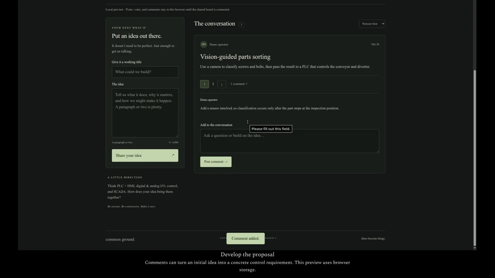

# Common Ground — capstone idea board

A small discussion board for developing capstone proposals. Participants enter a name, post an idea, vote, and add comments. It runs as a static site with optional Supabase storage.

[](https://trylen22.github.io/demos/ideas/)

[Watch the captioned demonstration](https://trylen22.github.io/demos/ideas/). The page also provides the MP4 and subtitle file.

The recording uses synthetic posts and browser storage. It does not write to the shared class board.

[Open the board](https://trylen22.github.io/capstone-idea-board/).

## Preview

For a local-only preview, use a separate checkout and set both values in `config.js` to empty strings before opening the page. A configured checkout connects to shared storage.

```bash
python3 -m http.server 8000 --bind 127.0.0.1
```

Open `http://127.0.0.1:8000/`. With empty configuration, posts, votes, and comments persist only in that browser. No build step is required.

## Connect shared storage

1. Create a free Supabase project at https://supabase.com/dashboard.
2. Run `schema.sql` in its SQL editor once.
3. Enable anonymous sign-ins in Authentication settings.
4. Set `supabaseUrl` and `supabaseKey` in `config.js` using the project's URL and **publishable key** (legacy anon key also works). Never put a secret/service-role key in this file.
5. Push the updated config to GitHub. Pages redeploys automatically.

Names are self-declared. Supabase silently creates a session so each browser can cast one vote per idea and only remove its own vote. Clearing browser data or using another device creates another identity; this is a casual group board, not verified voting. Names, ideas, and comments on the shared board are publicly readable by anyone with the site URL. Database policies enforce ownership and content limits. Rename affects future posts; old contributions retain their original name.

## Hosting

Publish only this directory in a dedicated GitHub repository, with Pages configured to deploy from the main branch root. No build step is needed. `.nojekyll` disables Jekyll. The live connection uses the Supabase JavaScript client from jsDelivr. The board refreshes every 30 seconds while idle; reload to refresh an open comment thread.

## Checks

`node --check app.js` checks syntax. Browser checks should cover required name, posting, vote/unvote, comments, sorting, reload persistence, safe text rendering, and mobile overflow. Shared database integration requires a configured Supabase project and running the schema.

## Adding downvotes to an existing board

Run `migrations/002-downvotes.sql` once before deploying the updated frontend. Existing votes become +1. Each browser can choose +1 or -1 per idea, click again to remove its vote, or switch direction. The displayed score is upvotes minus downvotes; Highest score sorts by that total.
